# 车牌识别与停车场管理系统

[](https://www.python.org/)
[](https://pypi.org/project/PyQt5/)
[](https://opencv.org/)
[](https://github.com/szad670401/HyperLPR)
[](./LICENSE)
[](./tests)

**一句话定位**：一个完全离线运行的中文车牌识别 + 停车场管理系统，桌面端 PyQt5，
数据落本地 SQLite。核心是把"真实车牌识别不准"这个问题做实了——双引擎并行 +
置信度仲裁 + 拒识，真实照片在 17 种退化条件下仍可识别。

> 课程设计项目，独立完成需求分析、识别方案设计、界面实现、测试与文档。2026 · Tangtc

<p align="center">
  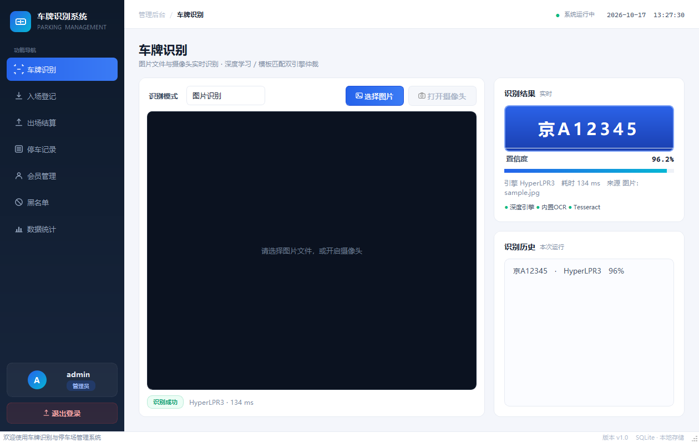
  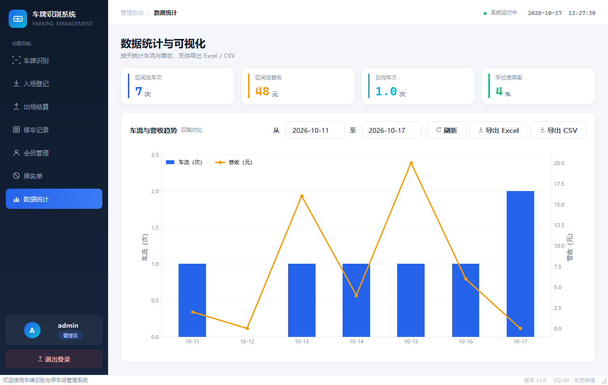
</p>
<p align="center">
  <sub>左：识别成功态（号牌 + 置信度 + 命中的引擎） · 右：数据统计看板</sub>
</p>

---

## 一、项目背景

停车场出入口的人工登记有三个实际问题：录入慢、容易打错车牌、纸质记录无法统计。
车牌识别看起来是"调个库就能用"的功能，但真正放到现实照片上会遇到两类失败：

- **传统模板匹配**依赖"车牌字体与模板字体一致"。真实车牌用国标 GA36 专用字体，
  与系统黑体差异明显，实测单字相似度只有 **0.33~0.43**，一张清晰的 `冀T15888`
  会被认成 `津T1111`。
- **深度模型**在真实抓拍上很稳，但对"纯车牌特写、没有车身上下文"的输入反而会错
  （训练分布不同，实测把 `沪B5M2N9` 认成 `沪B5N2N9`）。

所以本项目的重点不是"接一个 OCR"，而是**让两类引擎互补**：谁更可信由数据决定，
而不是写死。在此之上补了拒识机制——宁可提示"未识别"，也不把乱码写进业务表。

## 二、功能

| 模块 | 能力 | 权限 |
|---|---|---|
| 车牌识别 | 图片 / 摄像头实时识别；双引擎仲裁；结果叠加在画面上 | 全部 |
| 入场登记 | 自动分配空车位、写入入场时间、会员与黑名单校验 | 全部 |
| 出场结算 | 按车型与时长计费、会员折扣、输出结算单 | 全部 |
| 停车记录 | 条件筛选（时间 / 车牌 / 在场状态）、增删改、导出 Excel / CSV | 查全部，改限管理员 |
| 会员管理 | 车牌绑定、有效期、折扣率、续期 | 管理员 |
| 黑名单 | 新增 / 删除、入场时实时预警 | 管理员 |
| 数据统计 | 车流与营收趋势（按日历补齐空缺日）、指标卡、导出 | 全部 |
| 权限控制 | 管理员 / 操作员两级，导航项按角色禁用 | — |

### 界面

<table>
<tr>
<td width="50%">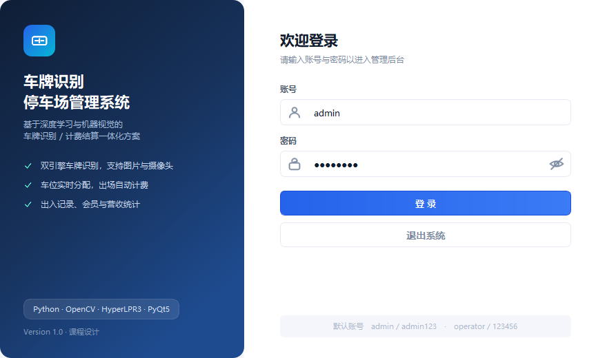<br><sub><b>登录</b> · 品牌分栏，错误提示内联展示，不弹窗打断</sub></td>
<td width="50%">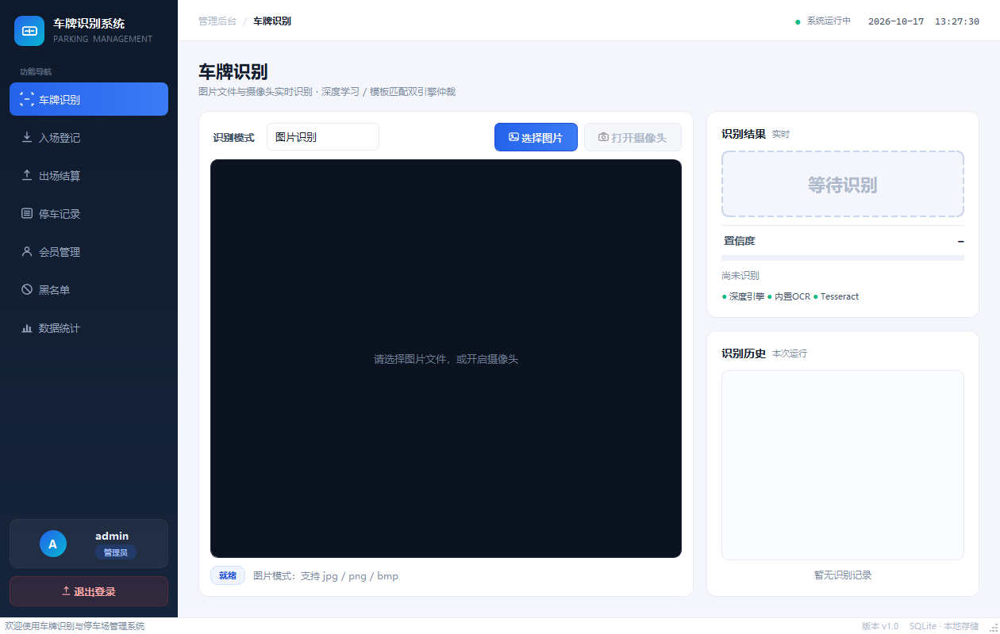<br><sub><b>车牌识别</b> · 左图像工作区 + 右结果面板</sub></td>
</tr>
<tr>
<td width="50%">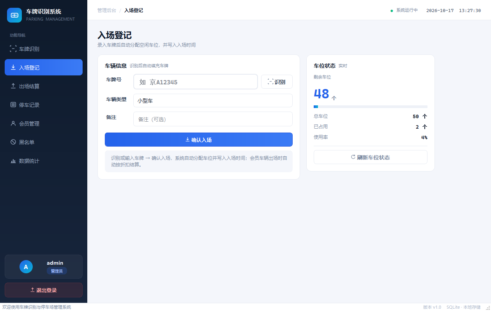<br><sub><b>入场登记</b> · 右侧车位看板，占用率 ≥70% 转黄、≥90% 转红</sub></td>
<td width="50%">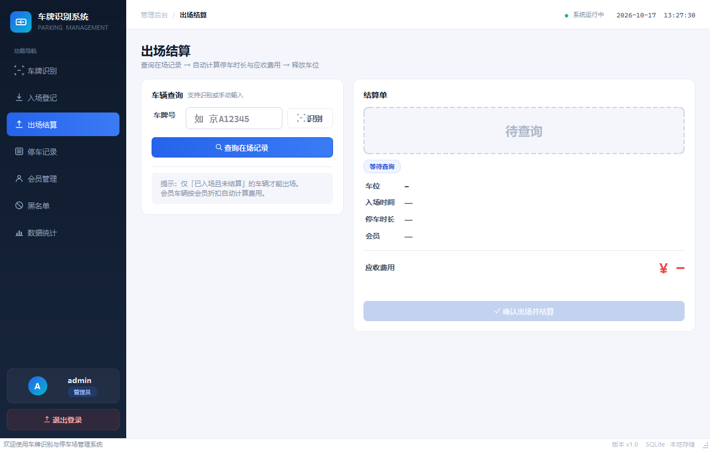<br><sub><b>出场结算</b> · 结算单式布局，应收金额为视觉重心</sub></td>
</tr>
<tr>
<td width="50%">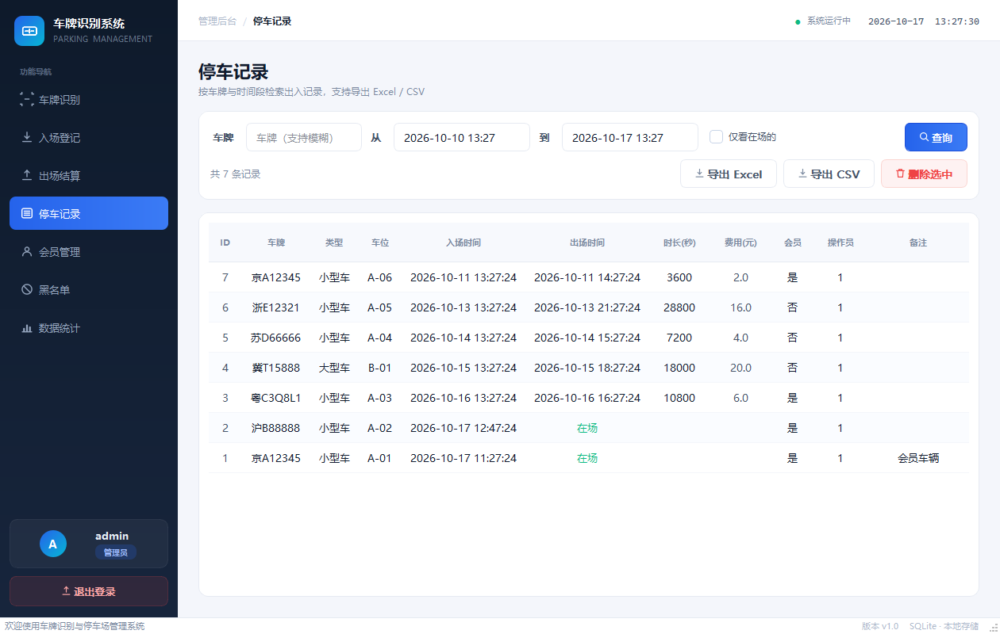<br><sub><b>停车记录</b> · 横排筛选条 + 表格，时间列不截断</sub></td>
<td width="50%">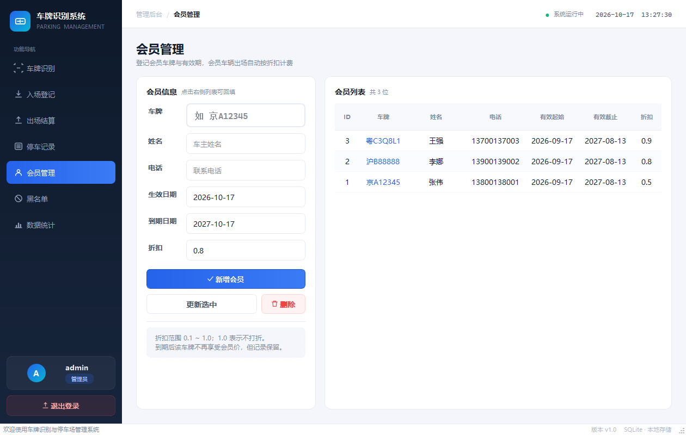<br><sub><b>会员管理</b> · 有效期与折扣率维护</sub></td>
</tr>
<tr>
<td width="50%">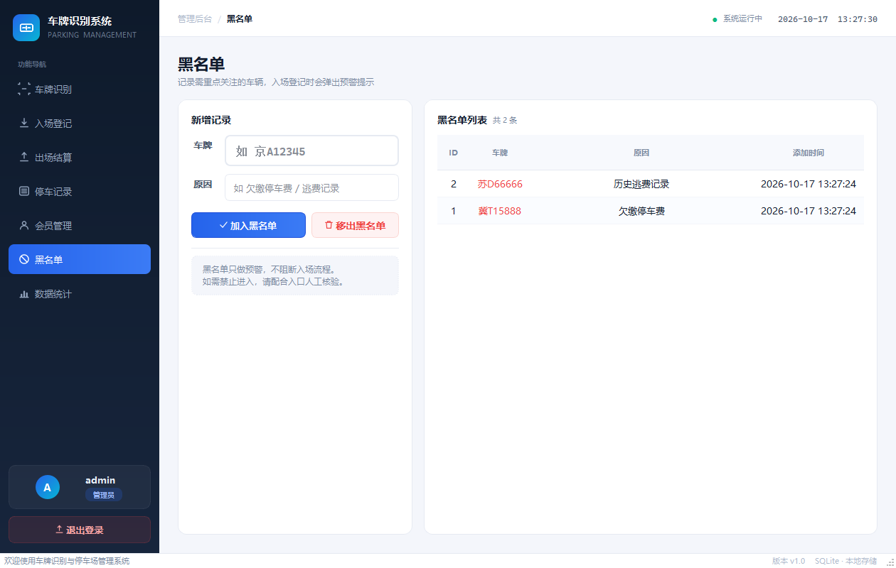<br><sub><b>黑名单</b> · 入场时实时预警</sub></td>
<td width="50%"><sub>界面全部用 PyQt5 原生控件 + QSS 实现，图标由 QPainter 现场绘制，
不依赖图标字体或 png 资源，换台电脑不会缺字形。配色与圆角统一由 <code>ui/theme.py</code> 管理。</sub></td>
</tr>
</table>

## 三、技术栈

| 层 | 选型 | 版本 |
|---|---|---|
| 语言 | Python | 3.12（实测）；3.10+ 理论可用 |
| 界面 | PyQt5 | 5.15.11 |
| 图像处理 | OpenCV | 4.13 |
| 车牌识别 | HyperLPR3（ONNX Runtime 推理）+ 内置模板 OCR | hyperlpr3 0.1.3 / onnxruntime 1.27 |
| 数据库 | SQLite3（标准库） | — |
| 可视化 / 导出 | Matplotlib、Pandas、openpyxl | 3.11 / 3.0 / 3.1 |
| 测试 | pytest | 9.1 |

**几个刻意的"不选"**：

| 没选 | 原因 |
|---|---|
| 云端 OCR（百度 / 腾讯 API） | 需要联网与 key，评分环境不可复现；本项目要求完全离线 |
| 自己训练检测模型 | 数据标注与算力成本远超课程设计范围，HyperLPR3 已开源可用且效果足够 |
| MySQL / PostgreSQL | 单机桌面应用，SQLite 零配置、可随项目整体拷走 |
| Electron / Web 前端 | 需要直接调用本机摄像头，桌面端省掉一层部署 |
| YOLOv8 自带的分类头 | 用的是 COCO 通用权重（无 plate 类），只能做"车辆粗定位"，不是车牌检测 |

## 四、架构

### 4.1 分层结构

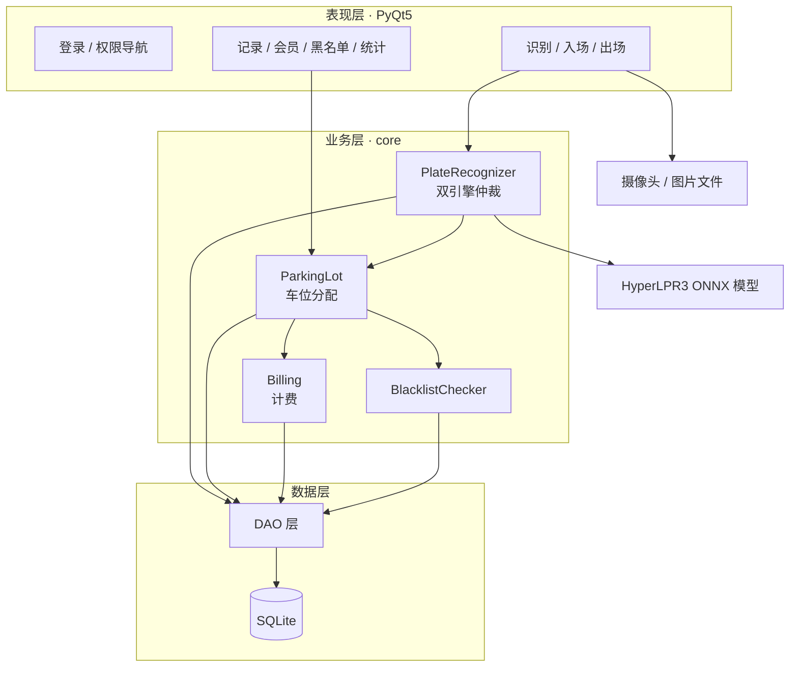

分层的实际收益：`core` 层不 import 任何 PyQt5，所以识别与计费逻辑可以在无 GUI 环境下
被 pytest 直接调用，也能被 `eval_recognition.py` 复用做批量评测——这两件事都是
"验证准确率"的前提。

### 4.2 识别流程与仲裁规则

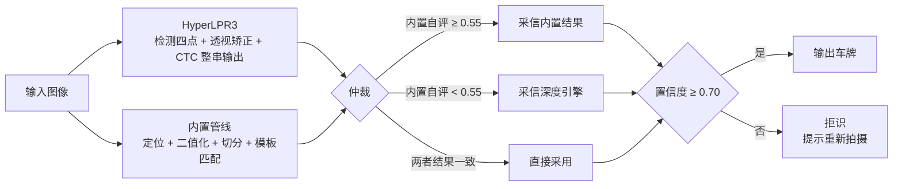

**为什么看"内置管线自评"而不是比较两个引擎的置信度？**
两者的置信度不是同一把尺子：内置管线输出的是"与模板的相似度"，HyperLPR3 输出的是
CTC 序列概率，直接比大小没有意义。而"内置管线对自己结果有多确信"恰好反映了一个
物理事实——**输入字体是否与模板同源**。相似度高说明输入就是这种字体渲染出来的，
可以采信；相似度低说明模板根本匹配不上，该换深度引擎。

阈值 `0.55` / `0.70` 由实测归纳得出（真实图内置自评 0.29，合成图 0.67~0.77），
写在 `config.py` 的 `PLATE_BUILTIN_SELF_TRUST` 与 `PLATE_MIN_CONFIDENCE`，可调。

## 五、快速开始

### 5.1 环境要求

| 项 | 要求 |
|---|---|
| 系统 | Windows 10/11（摄像头走 DirectShow；其他平台自动回退默认后端） |
| Python | 3.10+，**推荐 3.12**（仅 3.12 做过完整验证） |
| 摄像头 | 可选，没有也能用图片识别 |
| 网络 | 不需要。ONNX 模型（17.5 MB）随仓库提供 |

### 5.2 安装

```bash
git clone <你的仓库地址>
cd <仓库目录>

python -m venv .venv
.venv\Scripts\activate            # PowerShell: .venv\Scripts\Activate.ps1

pip install -r requirements.txt
python check_env.py               # 可选：逐项自检，缺什么会直接说
```

> `requirements.txt` 里 `ultralytics` 默认被注释掉：它会连带安装约 2 GB 的 PyTorch，
> 而缺少时程序会自动改用 OpenCV 做车辆粗定位，识别主路径（HyperLPR3）不受影响。

### 5.3 运行

```bash
python main.py
```

首次启动会建库并创建两个账号：

| 账号 | 密码 | 角色 | 能看到什么 |
|---|---|---|---|
| `admin` | `admin123` | 管理员 | 全部 7 个模块 |
| `operator` | `123456` | 操作员 | 停车记录 / 会员 / 黑名单 禁用或只读 |

密码以 PBKDF2-SHA256 加盐哈希存储，数据库里没有明文。

**想立刻看到识别效果**：进入「车牌识别」→ 直接点右上角「打开摄像头」（会自动切到摄像头模式），
约 1~2 秒出画面，每秒识别一次。也可以选「图片识别」，用 `data/images/` 里的样例图。

### 5.4 测试

```bash
python -m pytest tests -q              # 79 passed, 1 skipped
python eval_recognition.py --augment   # 准确率对比：内置管线 vs 双引擎
python test_recognition.py             # 逐张打印识别结果，人工观察用
```

`eval_recognition.py` 的真值表在 `data/labels.json`；`--augment` 会对真实照片生成
17 种退化样本（旋转 / 亮度 / 模糊 / 缩放 / 噪声 / 组合），用于量化抗干扰能力。

> 若机器上没有黑体（如 GitHub Actions 的 Windows runner），内置模板引擎会跳过 8 项
> 字体相关用例，输出变为 `71 passed, 9 skipped`——这是**预期行为**，原因见
> [7.1](#71-已知问题) 最后一条。

### 5.5 常见问题

| 现象 | 原因与处理 |
|---|---|
| `DLL load failed while importing onnxruntime_pybind11_state` | PyQt5 比 onnxruntime 先加载。`main.py` 顶部已强制先 `import onnxruntime`；写新入口脚本时照做（`os.add_dll_directory` 无效） |
| 摄像头打不开 | 先跑 `python -c "from core.camera import Camera; print(Camera.probe_devices(3))"` 看设备号，再改 `config.py` 的 `CAMERA_INDEX`。若被微信 / 腾讯会议占用，错误提示会直接说明 |
| 识别率明显偏低 | 大概率是 HyperLPR3 没生效、静默降级到内置管线。看界面引擎状态，或查日志里的 `DLL load failed` |
| 装了 Tesseract 仍不可用 | 路径含中文会报 `Illegal byte sequence`。设 `TESSERACT_DIR` 指向无中文目录；`tessdata` 为空时跑 `python fetch_tessdata.py` |
| 界面文字出现方块 | 缺中文字体（装「微软雅黑」）。图标是矢量绘制，不受影响 |
| 想重置数据库 | 删掉 `db/parking.db`，下次启动自动重建。该文件已在 `.gitignore` 中 |

## 六、目录结构

```
.
├── main.py                  # 入口：先 import onnxruntime，再启动 Qt
├── config.py                # 全局配置：费率、车位数、识别阈值、摄像头参数
├── check_env.py             # 环境自检，逐项给修复建议
├── requirements.txt
│
├── core/                    # 业务核心（不依赖 PyQt5，可单独测试）
│   ├── plate_recognizer.py  #   双引擎并行 + 仲裁 + 拒识
│   ├── lpr_engine.py        #   HyperLPR3 封装（单例、显式模型路径）
│   ├── template_ocr.py      #   内置模板 OCR（投影 / 网格双策略择优）
│   ├── camera.py            #   摄像头采集（多后端回退、必须真读到帧）
│   ├── billing.py           #   计费规则
│   ├── parking_lot.py       #   车位分配
│   └── blacklist_checker.py
│
├── ui/                      # 界面层
│   ├── theme.py             #   设计令牌 + 全局 QSS
│   ├── components.py        #   卡片 / 指标卡 / 号牌 / 徽章 / 按钮工厂
│   ├── icons.py             #   QPainter 现画的矢量图标
│   ├── main_window.py       #   侧栏 + 顶部条 + 内容栈
│   ├── login_window.py
│   └── *_widget.py          #   7 个功能页
│
├── db/                      # SQLite 与 DAO
│   ├── database.py
│   ├── init_db.sql
│   └── dao/
│
├── auth/                    # 登录、角色、密码哈希
├── utils/                   # 日志、图像工具、时间、导出、字体定位
├── tests/                   # pytest（79 项）
├── models/hyperlpr3/        # 4 个 ONNX 权重，随仓库分发
├── data/images/             # 测试样例图 + labels.json 真值表 + render_info.json 字体签名
├── docs/                    # 深度文档 + 界面截图
└── .github/workflows/       # CI：pytest + 准确率回归
```

## 七、已知问题与后续规划

### 7.1 已知问题

| 问题 | 现状与影响 |
|---|---|
| 抗干扰指标样本单一 | 17/17 来自**同一张真实照片**的退化变体，只能证明抗干扰，不能外推为任意车型都准 |
| 仲裁阈值是归纳值 | 0.55 / 0.70 由少量实测样本得出，样本扩大后可能需要调整；常量集中在 `config.py` |
| YOLOv8 用的是 COCO 通用权重 | 没有 plate 类，实际是"检出车框 → 框内二次定位"，真实车牌主要靠 HyperLPR3 |
| 车牌类型覆盖有限 | 只支持蓝牌 / 黄牌，未处理新能源绿牌、双层黄牌 |
| 单机 SQLite | 未做并发写入压力测试，多终端场景不适用（课程设计范围内可接受） |
| 仅在 Windows 验证 | macOS / Linux 需自行调整摄像头后端与 Tesseract 路径，代码里已留回退分支 |
| 内置模板引擎依赖「黑体」字形 | 模板匹配要求样例图与模板同字体。GitHub Actions 的 Windows 镜像**没有 `simhei.ttf`**，会回落到微软雅黑，此时合成样例图的 8/B、W/P 归一化后互相混淆（实测 6 张错 3~4 张）。测试读 `data/images/render_info.json` 里的字体签名，不一致即跳过；CI 的准确率门槛在这种情况下只校验真实照片 |
| 默认口令写在 config | 演示方便，但部署前必须改，见 `DEFAULT_USERS` |

### 7.2 后续规划

**近期（可验证）**

1. **接入 CCPD 数据集做批量评测**：替换"单张照片退化"的样本短板，输出分场景准确率
   （正常 / 倾斜 / 暗光 / 模糊），并把基线写进 CI。
2. **补充新能源绿牌**：8 位车牌格式 + 绿牌颜色判据，扩 `test_plate_validation.py`。
3. **覆盖率报告**：接 `pytest-cov`，目标 core 层 ≥ 80%。

**中期**

4. 录制操作演示 GIF 放进首屏（比静态图更直观）。
5. 用 PyInstaller 打包免安装 exe，降低别人的试用成本。
6. 多摄像头 / 多闸机：把 `Camera` 与 `ParkingLot` 解耦成可注入的服务。

## 八、测试结果

单元测试覆盖计费规则、车牌格式校验、登录与密码哈希、车位分配、统计口径、双引擎仲裁
（6 个分支）与摄像头失败路径。以下均为实际运行输出：

<p align="center">
  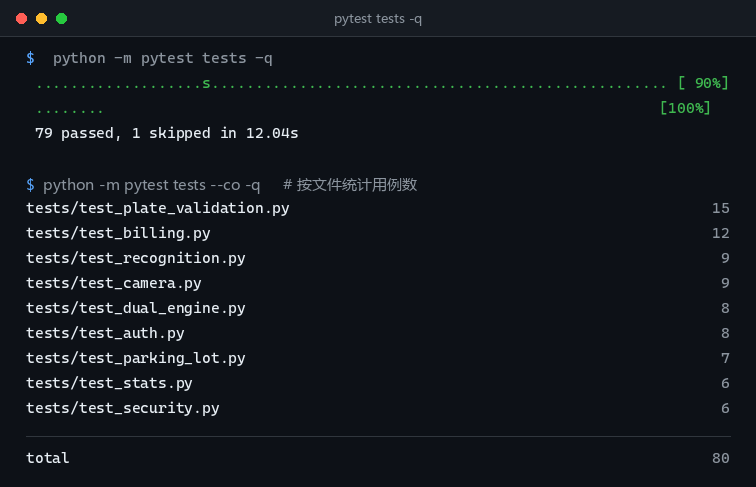
  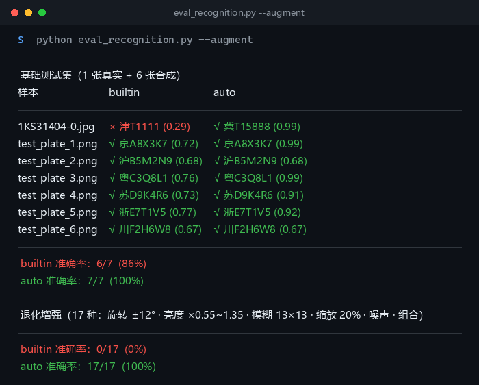
</p>

| 场景 | 仅内置管线 | 双引擎仲裁 |
|---|---|---|
| 基础测试集（1 真实 + 6 合成） | 6/7 (86%) | **7/7 (100%)** |
| 真实照片 17 种退化 | 0/17 (0%) | **17/17 (100%)** |

边界表现：缩小 18%、旋转 15°、模糊 17×17、亮度降到 0.2 仍可识别；单张稳态约 1.4s
（两引擎并行）。完整诊断过程见 [`docs/识别准确率报告.md`](./docs/accuracy-report.md)。

## 九、文档

只保留两份有独立价值的深度文档，其余内容已合并进本 README：

| 文档 | 内容 |
|---|---|
| [`docs/识别准确率报告.md`](./docs/accuracy-report.md) | 从二值化到字符切分的四段诊断、仲裁阈值的实测依据、DLL 加载顺序问题 |
| [`docs/数据库设计.md`](./docs/database-design.md) | 5 张表的字段、索引、统计口径 |

## 十、License

[MIT](./LICENSE) © 2026 Tangtc

第三方组件（HyperLPR3 的 Apache-2.0、可选依赖 YOLOv8 的 AGPL-3.0、以及
`data/images/` 真实车牌照片的版权归属）详见 [THIRD_PARTY_NOTICES.md](./THIRD_PARTY_NOTICES.md)。
